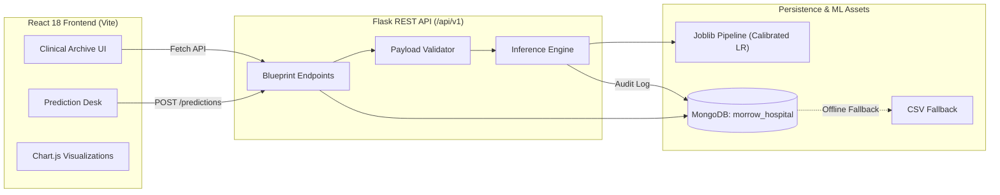

# MORROW — Healthcare Appointment No-Show Prediction System

[](https://www.python.org/)
[](https://flask.palletsprojects.com/)
[](https://react.dev/)
[](https://scikit-learn.org/)
[](https://www.mongodb.com/)
[](https://vitejs.dev/)
[](https://opensource.org/licenses/MIT)

**MORROW** is a production-grade clinical decision-support and hospital operations intelligence platform. It predicts the calibrated likelihood (`0.00` to `1.00`) of scheduled patient appointment non-attendance ("no-shows") at the time of booking. This enables administrative healthcare staff to review high-risk appointments, schedule courteous follow-ups, and optimize clinical schedule density without disrupting care delivery.

---

## Architecture Overview



### Strict Operational Scope & Governance
- **Administrative Decision Support Only:** Estimates scheduling risk; does *not* predict clinical diagnoses, patient health outcomes, or treatment acuity.
- **No Automated Actions:** Does *not* automatically cancel appointments or dispatch automated patient messages. Human operational review is required.
- **Synthetic Data Prototype:** Trained on a rigorously generated synthetic healthcare appointment simulation (`10,005` raw records, `9,950` cleaned). Zero real Protected Health Information (PHI) is used.

---

## Machine Learning Pipeline & Empirical Results

The pipeline enforces strict chronological splitting (70% train / 15% validation / 15% held-out test) with zero future or target leakage.

### 1. Data Cleaning & Reconciliation
- **Initial synthetic records:** `10,005`
- **Duplicate feature rows removed:** `49`
- **Duplicate ID conflicts resolved:** `1`
- **Inverted / invalid booking timestamps removed:** `5`
- **Cleaned dataset size:** `9,950` rows
- Missing historical count values are strictly retained for pipeline imputation (`SimpleImputer(strategy='median')`) to prevent split leakage.

### 2. Candidate Algorithm Benchmark (Validation Split, n = 1,492)

| Model | Accuracy | Precision | Recall | F1-Score | ROC-AUC | PR-AUC | Brier Score |
| :--- | :---: | :---: | :---: | :---: | :---: | :---: | :---: |
| DummyClassifier (`stratified`) | 0.7084 | 0.1860 | 0.1758 | 0.1808 | 0.5018 | 0.1835 | 0.2916 |
| **LogisticRegression (Selected)** | 0.6025 | 0.2232 | 0.4725 | **0.3032** | **0.5804** | **0.2384** | 0.2369 |
| RandomForestClassifier | 0.7239 | 0.2296 | 0.2161 | 0.2226 | 0.5570 | 0.2167 | 0.1982 |
| HistGradientBoostingClassifier | 0.8103 | 0.2727 | 0.0220 | 0.0407 | 0.5474 | 0.2199 | 0.1563 |

### 3. Chronological Held-Out Test Evaluation (Frozen Pipeline, n = 1,493)

- **Selected Pipeline:** Calibrated `LogisticRegression` (Sigmoid / Platt scaling on chronological validation slice).
- **Operational Decision Threshold:** `0.15` (optimized for asymmetric cost ratio: $5 False Positive review vs. $50 False Negative idle clinic slot).
- **Test Brier Score:** `0.1498` (superior to test prevalence-only reference `0.1515`).
- **Validation Brier Score:** `0.1480` (vs. validation prevalence-only reference `0.1495`).
- **Confusion Matrix ($t = 0.15$):**
  - True Negatives (TN): `617`
  - False Positives (FP): `598`
  - False Negatives (FN): `100`
  - True Positives (TP): `178` (64.03% recall on missed appointments)

---

## Repository Structure

```
Healthcare-Appointment-Prediction/
├── artifacts/                  # Serialized ML models, metrics, and curve plots
│   ├── figures/                # ROC, PR, calibration, and feature importance plots
│   ├── metrics/                # Benchmark JSONs and validation/test prediction arrays
│   └── models/                 # no_show_pipeline.joblib artifact
├── backend/                    # Flask REST application factory
│   ├── blueprints/             # Modular API routes (appointments, dashboard, predictions, etc.)
│   ├── config.py               # Environment configuration
│   ├── database.py             # PyMongo driver with CSV fallback
│   └── run.py                  # API server entry point
├── data/                       # Datasets
│   ├── raw/                    # Raw synthetic appointments CSV
│   └── processed/              # Cleaned appointments CSV (9,950 records)
├── frontend/                   # React 18 + Vite frontend
│   ├── src/
│   │   ├── api/                # API client with error handling
│   │   ├── components/         # Layout, charts, status badges, and tables
│   │   ├── pages/              # 6 core views (Overview, Appointments, Predict, Results, etc.)
│   │   └── styles/             # High-contrast clinical ledger styling & typography
├── ml/                         # End-to-end Machine Learning source code
│   ├── data/                   # Data generation and cleaning scripts
│   ├── eda/                    # Exploratory data analysis scripts
│   ├── features/               # Feature engineering pipelines
│   └── training/               # Model training, calibration, and evaluation
├── notebooks/                  # Interactive Jupyter analysis notebooks
├── scripts/                    # Shell and PowerShell utility automation scripts
├── tests/                      # Automated unit, integration, and ML verification tests
├── .env.example                # Safe environment variable template
├── .gitignore                  # Production exclusion rules
├── README.md                   # Project documentation
└── requirements.txt            # Python dependencies
```

---

## Quick Start & Installation

### Prerequisites
- **Python:** 3.10 to 3.13
- **Node.js:** 18+ and npm
- **MongoDB (Optional):** Local MongoDB Community Edition or MongoDB Atlas (app includes an automatic local CSV fallback if MongoDB is not running).

### 1. Clone the Repository
```bash
git clone https://github.com/JavedKhan93/Healthcare-Appointment-Prediction.git
cd Healthcare-Appointment-Prediction
```

### 2. Python Environment Setup
```bash
# Create virtual environment
python -m venv .venv

# Activate on Windows (PowerShell)
.\.venv\Scripts\Activate.ps1
# ...or on macOS/Linux:
# source .venv/bin/activate

# Install dependencies
pip install --upgrade pip
pip install -r requirements.txt

# Copy environment configuration
cp .env.example .env
```

### 3. Environment Variables (`.env`)
Configure `.env` as required (defaults work out-of-the-box for local development):
```env
# MongoDB Configuration
MONGODB_URI=mongodb://localhost:27017/
MONGODB_DATABASE=morrow_hospital

# Flask Configuration
FLASK_DEBUG=true
FLASK_PORT=5000
SECRET_KEY=dev-secret-key-replace-in-production

# Frontend (Vite)
VITE_API_BASE_URL=http://localhost:5000/api/v1
```

### 4. Start the Application

#### Terminal 1 — Backend API:
```bash
# Windows
.\.venv\Scripts\python.exe -m backend.run

# macOS / Linux
python -m backend.run
```
*API serves at `http://localhost:5000/api/v1`*

#### Terminal 2 — Frontend Development Server:
```bash
cd frontend
npm install
npm run dev
```
*Application opens at `http://localhost:5173/` (or port assigned by Vite)*

---

## REST API Reference (`/api/v1`)

| Method | Endpoint | Description |
| :--- | :--- | :--- |
| `GET` | `/api/v1/health` | Health check, MongoDB connection status, and model metadata |
| `GET` | `/api/v1/dashboard/summary` | Aggregate operational statistics (total, attended, no-show rate) |
| `GET` | `/api/v1/dashboard/trends` | Aggregations by weekday, booking channel, month, and hour |
| `GET` | `/api/v1/appointments` | Searchable, paginated appointment register with filter support |
| `GET` | `/api/v1/appointments/<id>` | Full booking and historical feature view for an appointment |
| `POST` | `/api/v1/predictions` | Submits appointment features for calibrated no-show inference |
| `GET` | `/api/v1/predictions/history` | Paginated log of historical inference submissions |
| `GET` | `/api/v1/model/metrics` | Validation comparison, held-out test table, and curve coordinates |
| `GET` | `/api/v1/model/feature-importance` | Permutation feature importance rankings |
| `GET` | `/api/v1/data-quality` | Data cleaning reconciliation and dataset dictionary |

---

## Testing & Quality Assurance

Run the test suite covering data generation, cleaning reconciliation, data leakage checks, inference contracts, and API endpoints:

```bash
# Run pytest suite
python -m pytest tests/ -v

# Run live API end-to-end verification
python scripts/verify_api.py

# Verify frontend production build
cd frontend && npm run build
```

---

## Security & Responsible Use Disclaimers

1. **No Sensitive Data or Credentials:** All credentials, keys, and tokens are excluded via `.gitignore`. Configuration uses `.env.example` templates.
2. **Clinical Decision Support Boundary:** This software is designed exclusively for administrative clinic operations. Predictions must never be used to withhold care, deprioritize clinical urgency, or make unilateral medical decisions.
3. **Model Interpretability:** Feature importance reflects predictive correlations on the synthetic validation split, not causal clinical explanations.

---

## License

This project is licensed under the [MIT License](LICENSE).
